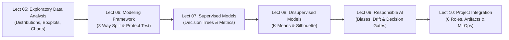

# 📘 10301351 Data Science: Master Final Exam Study Guide (Lectures 05–10)
> **Comprehensive High-Yield Synthesis & Clinical Exam Blueprint**  
> **Course:** 10301351 Data Science | **Lectures Covered:** Lect 05 (EDA), Lect 06 (Modeling), Lect 07 (Tree Models & Evaluation), Lect 08 (K-Means & Unsupervised), Lect 09 (Responsible AI & Ethics), Lect 10 (Project Integration & Governance)  
> **Framework Base:** 8-Stage CRISP-DS Lifecycle & Cross-Functional Data Delivery

---

## 📑 สารบัญภาพรวม (Table of Contents)
1. [ภาพรวมกรอบความคิด & แผนที่ข้อสอบ Final (CRISP-DS Lectures 05–10)](#1-ภาพรวมกรอบความคิด--แผนที่ข้อสอบ-final)
2. [Lecture 05: Exploratory Data Analysis (EDA) & Outlier Detection](#2-lecture-05-exploratory-data-analysis-eda--outlier-detection)
3. [Lecture 06: Modeling Framework & ยุทธศาสตร์การแบ่งชุดข้อมูล](#3-lecture-06-modeling-framework--ยุทธศาสตร์การแบ่งชุดข้อมูล)
4. [Lecture 07: Tree-Based Models & Classifier Evaluation Metrics](#4-lecture-07-tree-based-models--classifier-evaluation-metrics)
5. [Lecture 08: Unsupervised Learning — K-Means Clustering & การประเมินกลุ่ม](#5-lecture-08-unsupervised-learning--k-means-clustering--การประเมินกลุ่ม)
6. [Lecture 09: Responsible Data Science, อคติ และจริยธรรม AI](#6-lecture-09-responsible-data-science-อคติ-และจริยธรรม-ai)
7. [Lecture 10: Project Integration, CRISP-DS in Action & 6 บทบาททีมข้อมูล](#7-lecture-10-project-integration-crisp-ds-in-action--6-บทบาททีมข้อมูล)
8. [ตารางคลังสูตรเร่งด่วน 10 นาทีก่อนเข้าห้องสอบ (Master Cheat Sheet Table)](#8-ตารางคลังสูตรเร่งด่วน-10-นาทีก่อนเข้าห้องสอบ)

---

# 1. ภาพรวมกรอบความคิด & แผนที่ข้อสอบ Final

การสอบปลายภาควิชา 10301351 Data Science ร้อยเรียงเนื้อหาตั้งแต่การสำรวจข้อมูล (EDA) ไปจนถึงการส่งมอบงานและการเฝ้าระวังระบบในโลกจริง:



### 🎯 เมทริกซ์ 12 กับดักข้อสอบยอดฮิต (Top 12 Exam Traps Matrix)
| ลำดับ | ประเด็นกับดักในข้อสอบ | ความเข้าใจผิดที่พบบ่อย | ความจริงที่ถูกต้องตามสไลด์อาจารย์ | สไลด์อ้างอิง |
|:---:|:---|:---|:---|:---:|
| 1 | **บทบาทของ EDA** | คิดว่า EDA ทำหน้าที่ตัดสินใจเลือกอัลกอริทึม ML ที่ดีที่สุดให้อัตโนมัติ | EDA ทำหน้าที่ **Informs modeling decisions** (ชี้แนะแนวทาง) แต่ **not automatically selects algorithm** | Lect 05 p04, p28 |
| 2 | **เส้นหนวดของ Boxplot (Whisker Rule)** | คิดว่าเส้นหนวดลากยาวไปหยุดที่ตัวเลขรั้ว Fence พอดี | เส้น Whisker ลากไปหยุดที่ **"ค่าจริงในข้อมูลที่ไกลที่สุดแต่ยังอยู่ภายในรั้ว"** ไม่ใช่ลากไปที่ตัว Fence | Lect 05 p17–18 |
| 3 | **Potential Outlier vs Error** | เมื่อพบค่าหลุดรั้ว Tukey ให้ตัดแถวนั้นทิ้งทันที | ค่าหลุดรั้วคือ **Potential Outlier $\neq$ Error** ต้องตรวจสอบก่อน หากเป็นค่าจริงตามธรรมชาติห้ามลบมั่ว | Lect 05 p17–18 |
| 4 | **Correlation vs Causality** | Scatter plot ชันขึ้นแปลว่า X เป็นสาเหตุให้เกิด Y | **Correlation Is Association, Not Causation** ต้องระวังตัวแปรกวนแฝง (Confounding Variables) | Lect 05 p13 / Lect 10 p10 |
| 5 | **Protect the Test Set** | นำ Test Set มาจูน max_depth หรือเลือกโมเดลที่ดีที่สุด | Test Set ใช้ประเมินความสามารถ Generalization **เพียงครั้งเดียวตอนสุดท้าย** ห้ามแตะต้องในขั้นตอนจูน | Lect 06 / Lect 07 p32 |
| 6 | **Splitting Criterion** | เลือกกิ่งที่ได้ Gini_split สูงที่สุด | ต้องเลือกกิ่งที่ได้ **Gini_split ต่ำสุด** ซึ่งส่งผลให้ได้ **Gini Gain สูงสุด** | Lect 07 p11–12 |
| 7 | **Tree Complexity** | ต้นไม้ที่แตกกิ่งลึกที่สุด (Unrestricted) ดีที่สุดเพราะ Train Acc = 100% | ต้นไม้ลึกเกินไปเกิด **Overfitting** (High Variance) ค่าที่เหมาะสมคือระดับกลาง (Moderate max_depth = 3) | Lect 07 p19, p31 |
| 8 | **Confusion Matrix Axes** | จำว่าแถวเป็น Predicted คอลัมน์เป็น Actual | สไลด์วิชานี้ใช้ **แถว = Actual (จริง)** และ **คอลัมน์ = Predicted (ทำนาย)** และต้องเขียน `Positive Class = ...` บรรทัดแรก | Lect 07 p22 |
| 9 | **Distance Trap in K-Means** | นำสูตร Squared Euclidean ไปใช้ตอนจัดจุดเข้ากลุ่ม | ขั้นตอน Assign จุดในสไลด์ใช้ **Manhattan Distance** ($L_1$) เพื่อคิดเลขง่าย ส่วน **Inertia/WCSS** ใช้ Squared Euclidean ($L_2^2$) | Lect 08 p25, p35 |
| 10 | **Proxy Features Bias** | คิดว่าการลบคอลัมน์เพศ/เชื้อชาติจะขจัดอคติได้สมบูรณ์ | ตัวแปรอื่นอย่าง **รหัสไปรษณีย์ (ZIP Code)** ทำหน้าที่เป็น Proxy บ่งบอกเชื้อชาติ/ฐานะทางอ้อม | Lect 09 p13 |
| 11 | **Concept Drift** | คิดว่า Concept Drift คือค่าเฉลี่ยของ Feature เปลี่ยนแปลง | Concept Drift คือ **ความสัมพันธ์ $P(Y \mid X)$ เปลี่ยนไป** เช่น ลูกค้าไม่ซื้อ 45 วัน $\to$ 70 วัน ทำให้ Recall ตกเหลือ 54% | Lect 09 p11, p20 |
| 12 | **Subgroup Disparity** | เชื่อใจ Overall Accuracy 84% ว่าโมเดลพร้อมใช้งานทันที | Overall Accuracy 84% อาจกลบเกลื่อนปัญหา เช่น **Recall ในกลุ่มลูกค้าใหม่ต่ำเพียง 54%** ต้องสั่ง "ปรับก่อนใช้" | Lect 10 p11, p14 |

---

# 2. Lecture 05: Exploratory Data Analysis (EDA) & Outlier Detection

## 2.1 ตำแหน่งและบทบาทของ EDA ใน CRISP-DS (Lect 05 p02–04, p28)
- **ตำแหน่งในวงจร:** EDA ทำหน้าที่เป็นสะพานเชื่อมระหว่าง **Data Preparation** และ **Modeling** (โดย Initial EDA สามารถเริ่มได้ตั้งแต่ Data Understanding)
- **EDA Is an Iterative Checkpoint (จุดตรวจสอบแบบวนซ้ำ):**
  - **Forward Path (เดินหน้า):** ผลิต *หลักฐานน่าเชื่อถือ (Credible Evidence)* $\to$ *Pattern & Insight* $\to$ *ชี้แนะแนวทางโมเดล (Informs Modeling)*
  - **Loopback Path (ย้อนกลับ):**
    - คำถามไม่ชัด $\implies$ ย้อนกลับไปปรับ **Analytical Question**
    - ความหมายคลุมเครือ $\implies$ ย้อนกลับไป **Data Understanding**
    - ฟีเจอร์มีปัญหา/ผิดปกติ $\implies$ ย้อนกลับไป **Data Preparation**
- **กฎทองของ EDA:**
  > **"อย่าเริ่ม EDA ด้วยกราฟ ให้เริ่มด้วยคำถาม (Begin EDA with an Analytical Question, not visualizations)"**  
  > ลำดับขั้นตอนที่ถูกต้อง: **Analytical Question** $\longrightarrow$ **Identify Variables** $\longrightarrow$ **Summary & Comparison** $\longrightarrow$ **Targeted Visualization**

---

## 2.2 ค่ากลาง (Measures of Center) และรูปร่างการกระจายตัว (Distribution Shapes)

### 1. การเลือกค่ากลางตามชนิดข้อมูล (Lect 05 p06)
- **Mean (ค่าเฉลี่ยเลขคณิต):** นำทุกค่ามาคิด เหมาะกับข้อมูลเชิงปริมาณ (Quantitative) ที่มีการกระจายตัวแบบสมมาตร **ไวต่อ Outliers มาก**
- **Median (มัธยฐาน):** ค่ากึ่งกลางข้อมูลเมื่อนำมาเรียงลำดับ ($50^{\text{th}}$ Percentile) **มีความทนทาน (Robust) ต่อ Outliers และ Skewness สูง** จึงเหมาะกับข้อมูลที่เบ้หรือมีค่าสุดโต่ง (เช่น รายได้, ยอดซื้อ)
- **Mode (ฐานนิยม):** ค่าหรือหมวดหมู่ที่เกิดขึ้นบ่อยที่สุด เหมาะกับข้อมูลเชิงคุณภาพ/จัดหมวดหมู่ (Categorical / Nominal Data)

### 2. รูปร่างการกระจายตัวและลำดับค่ากลาง (Distribution Shapes - Lect 05 p08)
```
  [ Symmetric / Normal ]           [ Right-skewed / Positive Skew ]
           /\                                   /\
          /  \                                 /  \
         /    \                               /    \________
   Mean = Med = Mode                     Mode < Med < Mean  (หางยาวขวา)
```
- **Symmetric Distribution:** ข้อมูลกระจายสมดุลสองข้าง ค่า $\text{Mean} \approx \text{Median} \approx \text{Mode}$
- **Right-skewed (Positive Skew):** หางยาวลาดไปทางขวา ค่าสุดโต่งฝั่งบวกจะฉุดค่าเฉลี่ยให้ลอยสูงขึ้น $\implies \mathbf{\text{Mode} < \text{Median} < \text{Mean}}$
- **Left-skewed (Negative Skew):** หางยาวลาดไปทางซ้าย ค่าสุดโต่งฝั่งลบจะฉุดค่าเฉลี่ยให้ดิ่งลง $\implies \mathbf{\text{Mean} < \text{Median} < \text{Mode}}$
- **Bimodal / Multiple Peaks:** มีจุดยอด 2 จุดขึ้นไป บ่งบอกว่ามีประชากรแฝงที่แยกย่อยอยู่ในกลุ่มข้อมูล (Sub-populations) ควรแยกกลุ่มก่อนวิเคราะห์

---

## 2.3 การวัดการกระจายตัว (Measures of Spread) & Anscombe’s Quartet (Lect 05 p07, p09)
- **"Spread Shows What the Center Leaves Out":** ข้อมูล 2 ชุดอาจมีค่า Mean และ Median เท่ากันพอดี แต่การกระจายตัว (Spread) ต่างกันสิ้นเชิง:
  - **Range:** $\text{Max} - \text{Min}$ (หยาบที่สุด และไวต่อค่าสุดโต่งที่สุด)
  - **Variance ($\sigma^2$) & Standard Deviation ($\sigma$):** วัดระยะห่างเฉลี่ยจาก Mean (ไวต่อ Outliers)
  - **Interquartile Range (IQR):** $Q_3 - Q_1$ วัดความกว้างของข้อมูลช่วงกลาง 50% (**Robust ต่อ Outliers**)
- **Anscombe’s Quartet Principle:** สถิติสรุป (Mean, SD, Correlation) เพียงอย่างเดียวไม่เพียงพอ เพราะข้อมูลที่มีค่าสถิติเท่ากันอาจมีรูปแบบภาพกราฟ (Structure) แตกต่างกันโดยสิ้นเชิง $\implies$ *"ใช้ Statistics เพื่อความแม่นยำ และใช้ Visualization เพื่อมองเห็นโครงสร้าง"*

---

## 2.4 การตรวจจับ Outlier ด้วย Tukey’s Fences & โครงสร้าง Boxplot (Lect 05 p17–18)

### 1. สูตรคำนวณรั้วของ Tukey (Tukey's Fences)
$$IQR = Q_3 - Q_1 \quad (\text{ช่วงข้อมูลกึ่งกลาง } 50\%)$$
$$\text{Lower Fence (รั้วล่าง)} = Q_1 - 1.5 \times IQR$$
$$\text{Upper Fence (รั้วบน)} = Q_3 + 1.5 \times IQR$$
- ข้อมูล $x$ ใดที่มีค่า $x < \text{Lower Fence}$ หรือ $x > \text{Upper Fence}$ จะถูกตั้งสถานะเป็น **Potential Outlier**

### 2. โครงสร้าง Boxplot (5-Number Summary) และกฎเหล็กเส้นหนวด (Whisker Rule)
```
          Lower Fence                                            Upper Fence
            (สมมติ)         Q1       Median       Q3               (สมมติ)
               │          ┌───────┬────────────┐   │                  │
   Outlier     │  ├───────┤       │            ├───┤  Outlier         │      Outlier
      *        │  │       └───────┴────────────┘   │     *            │         *
               └──┴────────────────────────────────┴──────────────────┘
                 Min(ในรั้ว)                      Max(ในรั้ว)
                 ▲                                ▲
                 └────── เส้นหนวด (Whisker) ──────┘
```
- **กฎเหล็กห้องสอบ (Whisker Rule):**
  > [!IMPORTANT]
  > เส้นหนวด (Whisker) ของ Boxplot จะลากยาวไปหยุดที่ **"ค่าข้อมูลจริงตัวสุดท้ายที่ยังอยู่ภายในรั้ว"** (Most extreme observation within fences)  
  > **ห้ามลากเส้นหนวดไปหยุดที่ตัวเลขรั้ว Fence** เพราะ Fence เป็นเพียงเกณฑ์เส้นสมมติที่คำนวณขึ้น!

### 🧮 ตัวอย่างคำนวณจริงในสไลด์และข้อสอบ
- **โจทย์:** ชุดข้อมูลมี $Q_1 = 30$ และ $Q_3 = 70$ พบจุดข้อมูล $x = 140$ จงพิจารณาว่า $x$ เป็น Outlier หรือไม่
  1. $IQR = Q_3 - Q_1 = 70 - 30 = 40$
  2. $\text{Upper Fence} = Q_3 + (1.5 \times IQR) = 70 + (1.5 \times 40) = 70 + 60 = \mathbf{130}$
  3. $\text{Lower Fence} = Q_1 - (1.5 \times IQR) = 30 - 60 = \mathbf{-30}$
  4. **สรุป:** ค่า $x = 140$ มากกว่ารั้วบน $130$ ($140 > 130$) $\implies$ **จัดเป็น Potential Outlier!**

### 3. แนวทางการจัดการ Outlier (ผิดสังเกต $\neq$ ต้องลบ)
- **Potential Outlier $\neq$ Error:** ค่าผิดสังเกตอาจเป็นพฤติกรรมจริงของมนุษย์ (เช่น ลูกค้า VIP มหาเศรษฐี) หรือเป็นข้อผิดพลาดในการบันทึก (Data Entry Error เช่น ใส่ศูนย์เกิน)
- **หลักปฏิบัติ:** ตรวจสอบที่มาก่อนตัดสินใจ ห้ามกด Delete ลบทิ้งทันทีโดยไม่สืบสวน!

---

## 2.5 คู่มือเลือกชาร์ต Tableau และ Visual Encoding (Lect 05 p19–26)

### 1. Matrix การเลือกกราฟตามวัตถุประสงค์ (Tableau Guide - Slide 19)
| หมวดหมู่วัตถุประสงค์ (Analytical Goal) | กราฟที่เหมาะสม (Recommended Charts) | จุดเน้นและข้อควรระวังในห้องสอบ |
|:---|:---|:---|
| **Comparison (เปรียบเทียบหมวดหมู่)** | **Bar Chart**, Column Chart | **แกนตัวเลขต้องเริ่มต้นที่ 0 เสมอ (Zero Baseline)** ห้ามตัดแกนให้ดูห่างเกินจริง |
| **Time / Trend (แนวโน้มตามเวลา)** | **Line Chart**, Area Chart, Dual Axis | แกน X ต้องเป็นเวลาต่อเนื่องและเรียงลำดับ ห้ามสลับลำดับหมวดเวลา |
| **Composition (สัดส่วนของทั้งหมด)** | **Treemap**, Stacked Bar, Pie Chart | **Pie Chart** ใช้ได้เมื่อมีสัดส่วนไม่เกิน 5 ชิ้นและรวมได้ 100% ถ้าซับซ้อนให้ใช้ **Treemap** |
| **Distribution (การกระจายตัว)** | **Histogram**, **Boxplot** | Histogram แสดงความเบ้และยอดคลื่น, Boxplot แสดง 5 ค่าสรุปและ Outliers |
| **Relationship (ความสัมพันธ์ 2 ตัวแปร)**| **Scatter Plot** | ใช้หาทิศทาง ความชัน และคลัสเตอร์ แต่พึงระลึกว่า Correlation $\neq$ Causation |
| **Geographic (เชิงพื้นที่)** | **Map** (Choropleth, Symbol Map) | แสดงข้อมูลตามพิกัด ภูมิภาค หรือรหัสไปรษณีย์ |
| **Magnitude / Matrix Table** | **Heat Map**, Highlight Table | ใช้ความเข้มของสีแสดงระดับตัวเลขในตารางกริด |

### 2. หลักการใช้สีและ Accessibility (Lect 05 p23–25)
- **3 ชนิดของชุดสี (Color Palettes):**
  1. **Categorical / Qualitative:** สีต่างโทนกัน ใช้แยกแยะข้อมูลประเภทที่ไม่มีลำดับ (เช่น กลุ่มลูกค้า A, B, C)
  2. **Sequential:** สีโทนเดียวไล่น้ำหนักจากอ่อนไปเข้ม ใช้แสดงปริมาณจากน้อยไปมาก (เช่น ยอดขาย)
  3. **Diverging:** สีสองเฉดแยกออกจากจุดกึ่งกลาง (Neutral Point) ใช้แสดงข้อมูลที่มีสองขั้วชัดเจน (เช่น กำไร [+] vs ขาดทุน [-])
- **Redundant Encoding (การเข้ารหัสคู่ขนาน):** กราฟที่ดีต้องสื่อความหมายได้แม้ไม่มีสี (สำหรับคนตาบอดสี Color Vision Deficiency หรือพิมพ์ขาวดำ) โดยใช้ **สี + ตัวอักษร (Color + Label)**, **สี + รูปทรง (Color + Shape)** หรือ **สี + ลวดลายเส้น (Color + Pattern)**

### 3. Exploratory vs. Explanatory Visualization (Lect 05 p26)
- **Exploratory (เพื่อนักวิเคราะห์):** มุ่งค้นหา มีคำถามมากมาย กราฟมีความละเอียดซับซ้อน เพื่อหา *Candidate Evidence*
- **Explanatory (เพื่อผู้ชม/ผู้บริหาร):** มุ่งสื่อสาร คัดสรรเพียง 1 ข้อความหลัก (One Main Message) พร้อมบริบทที่จำเป็นอย่างชัดเจน

---

# 3. Lecture 06: Modeling Framework & ยุทธศาสตร์การแบ่งชุดข้อมูล

## 3.1 นิยาม Supervised vs. Unsupervised Learning
- **Supervised Learning (การเรียนรู้แบบมีผู้สอน):** มี Target Label ($Y$) ชัดเจน
  - *Classification:* ทายตัวแปรหมวดหมู่ (Yes/No, Play/Not Play, Churn/Active)
  - *Regression:* ทายตัวเลขต่อเนื่อง (ยอดขาย, อุณหภูมิ, ราคาบ้าน)
- **Unsupervised Learning (การเรียนรู้แบบไม่มีผู้สอน):** ไม่มี Label ($Y$) มุ่งค้นหากลุ่มหรือโครงสร้างภายใน (Clustering, PCA)

## 3.2 กฎการแบ่งข้อมูล 3 ส่วน (3-Way Data Partitioning - Lect 07 p32)
1. **Training Set (60% – 70%):** ใช้สอนโมเดลเรียนรู้ความสัมพันธ์ (Fit Parameters, กฎ If-Else)
2. **Validation Set (15% – 20%):** ใช้ปรับจูน Hyperparameter (`max_depth`, ค่า `k`) และคัดเลือกโมเดลที่ดีที่สุด
3. **Test Set (15% – 20%):** **"Protected Test Set"** ใช้ประเมินความสามารถ Generalization **เพียงครั้งเดียวตอนสุดท้าย**
   > [!CAUTION]
   > ห้ามนำ Test Set มาใช้จูนโมเดล, ห้ามใช้เลือก Candidate และห้ามนำไป Fit Scaler รวมกับชุด Train เด็ดขาด!

## 3.3 ตารางเปรียบเทียบ 4 ตระกูล Candidate Models (Lect 07 p33)
| ตระกูลโมเดล | กลไกการเรียนรู้ | Interpretability | Scaling จำเป็นไหม? | จุดระวังสำคัญ |
|:---|:---|:---:|:---:|:---|
| **1. Decision Tree** | กฎ If-Else ลด Gini | สูงมาก (White-box) | **ไม่จำเป็น** | ตีความง่าย แต่เสี่ยง Overfitting เมื่อลึก |
| **2. 5-NN** | วัดระยะห่าง โหวต $k=5$ | ปานกลาง | **จำเป็นอย่างยิ่ง!** | ไวต่อสเกลตัวแปรมาก |
| **3. Naive Bayes** | ความน่าจะเป็นเบย์ $P(Y \mid X)$ | สูง | **ไม่จำเป็น** | สันนิษฐานว่าทุกฟีเจอร์เป็นอิสระต่อกัน |
| **4. Neural Network** | โครงข่ายหลายชั้น + Weights | ต่ำมาก (Black-box) | **จำเป็นอย่างยิ่ง!** | จับ Non-linear ได้ดี แต่ต้องการข้อมูลมาก |

---

# 4. Lecture 07: Tree-Based Models & Classifier Evaluation Metrics

## 4.1 คณิตศาสตร์ Decision Tree: Gini Impurity & Gini Gain (Lect 07 p11–12)
1. **Gini ของโหนดเดี่ยว:** $\text{Gini}(t) = 1 - \sum (p_i)^2$ (Binary: บริสุทธิ์ $= 0.000$, ปนกัน $50:50 = 0.500$)
2. **Weighted Gini Split:** $\text{Gini}_{\text{split}} = \left(\frac{n_L}{N}\right) \text{Gini}(L) + \left(\frac{n_R}{N}\right) \text{Gini}(R)$
3. **Gini Gain:** $\text{Gain} = \text{Gini}(\text{Parent}) - \text{Gini}_{\text{split}}$ $\implies$ **เลือกกิ่งที่ Gain สูงสุด ($\text{Gini}_{\text{split}}$ ต่ำสุด)**

### 🧮 ตัวอย่างจริงจากสไลด์ (Parent: Play = 6, Not Play = 6 $\to \text{Gini} = 0.500$)
- **Candidate Split A:** ซ้าย [5, 1], ขวา [1, 5] $\implies \text{Gini}_{\text{split}} = 0.278 \implies \mathbf{\text{Gain} = 0.222}$ (ชนะ!)
- **Candidate Split B:** ซ้าย [4, 2], ขวา [2, 4] $\implies \text{Gini}_{\text{split}} = 0.444 \implies \text{Gain} = 0.056$

## 4.2 บันไดความซับซ้อนต้นไม้ & Bias-Variance Tradeoff (Lect 07 p19, p31)
- `max_depth = 1` (Shallow): High Bias, Low Variance $\implies$ **Underfitting**
- `max_depth = 3` (Moderate): Balanced $\implies$ **Appropriate Fit (คะแนน Validation สูงสุด - เลือกตัวนี้!)**
- `max_depth >= 6` หรือ Unrestricted: Low Bias, Extreme Variance $\implies$ **Overfitting (จำ Train 100% แต่ Validation ตกฮวบ)**

## 4.3 Confusion Matrix & เมตริกวัดผล 4 ชนิด (Lect 07 p22–35)
สไลด์วิชานี้: **แถว = Actual (จริง)**, **คอลัมน์ = Predicted (ทำนาย)**
- **Accuracy:** $\frac{TP + TN}{TP + TN + FP + FN}$ (ห้ามใช้เดี่ยวๆ กับ Imbalanced Data)
- **Precision:** $\frac{TP}{TP + FP}$ (**เน้นลด FP** เช่น ระบบสแปม หรือแคมเปญที่มีต้นทุนต่อหัวแพงมาก)
- **Recall (Sensitivity):** $\frac{TP}{TP + FN}$ (**เน้นลด FN** เช่น ตรวจมะเร็ง หรือตามจับลูกค้า Churn ก่อนหนี)
- **F1-Score:** $\frac{2 \times \text{Precision} \times \text{Recall}}{\text{Precision} + \text{Recall}} = \frac{2TP}{2TP + FP + FN}$ (สมดุลฮาร์โมนิก)

### รวมโจทย์คำนวณจริงในสไลด์:
- **FIFA 2026 ($N=10$, Pos = Play):** $TP=4, FN=2, FP=1, TN=3 \implies \text{Acc}=0.70, \text{Prec}=0.80, \text{Rec}=0.67, \text{F1}=0.73$
- **HW#1 Churn ($N=10$, Pos = Inactive):** $TP=3, FN=2, FP=2, TN=3 \implies \text{ทุกเมตริกเท่ากัน} = \mathbf{0.60}$
- **HW#2 Trade-off ($N=100$, Actual Inactive = 40):**
  - *Model A (Conservative):* Prec สูงสุด (0.89) แต่ Rec ต่ำ (0.60) $\to$ เหมาะเมื่อแคมเปญแพงมาก
  - *Model B (Aggressive):* Rec สูงสุด (0.90) $\to$ เหมาะเมื่อธุรกิจกลัวเสียลูกค้าอย่างรุนแรง (ยอมเสียโทรฟรี FP=18)
  - *Model C (Balanced Winner):* $\text{Acc}=0.85, \text{F1}=0.81$ $\to$ **ผู้ชนะในภาพรวม**

---

# 5. Lecture 08: Unsupervised Learning — K-Means Clustering & การประเมินกลุ่ม

## 5.1 เป้าหมายและระยะทาง (Lect 08 p12, p25, p35)
- **เป้าหมาย:** **Maximize Intra-cluster Similarity** (ในกลุ่มชิดกันที่สุด) และ **Minimize Inter-cluster Similarity** (ต่างกลุ่มห่างกันที่สุด)
- **Manhattan Distance ($L_1$):** $d(X, Y) = \sum |x_i - y_i|$ *(ใช้คำนวณมือจัดจุดเข้ากลุ่ม 8 จุดในสไลด์)*
- **Euclidean Distance ($L_2$):** $d(X, Y) = \sqrt{\sum (x_i - y_i)^2}$

## 5.2 ตัวอย่างคำนวณ 8 จุดจริง ($A_1 \dots A_8$) จบรอบที่ 1 (Lect 08 p25–28)
- จุดเริ่มต้น: $C_1(2,10), C_2(5,8), C_3(1,2)$
- ผลจัดกลุ่ม: $\text{Cluster 1}=\{A_1\}, \text{Cluster 2}=\{A_3,A_4,A_5,A_6,A_8\}, \text{Cluster 3}=\{A_2,A_7\}$
- **Centroids ใหม่:** $C_1^{\text{new}} = (2,10), C_2^{\text{new}} = (6,6), C_3^{\text{new}} = (1.5, 3.5)$

## 5.3 การประเมิน Cluster (Inertia & Silhouette)
- **Inertia / WCSS:** $\sum \|x - C_k\|^2$ (ใช้ **Squared Euclidean**) $\implies$ เลือก $k$ ด้วย **Elbow Method**
- **Silhouette Score:** $s(i) = \frac{b(i) - a(i)}{\max(a(i), b(i))}$
  - $a(i)$ = ระยะเฉลี่ยในกลุ่มเดียวกัน (ยิ่งน้อยยิ่งดี), $b(i)$ = ระยะเฉลี่ยถึงกลุ่มข้างเคียงใกล้สุด (ยิ่งมากยิ่งดี)
  - **การแปลผล:** ใกล้ $+1$ ดีเยี่ยม, ใกล้ $0$ อยู่ขอบรอยต่อ, **ติดลบ แปลว่าอยู่ผิดกลุ่ม!**

---

# 6. Lecture 09: Responsible Data Science, อคติ และจริยธรรม AI

## 6.1 อคติ 3 รูปแบบ & Concept Drift (Lect 09 p08–20)
1. **Historical Bias:** อคติจากอดีต (เช่น ในอดีตส่งโปรโมชันเฉพาะ VIP ทำให้ VIP ตอบรับ 80% Non-VIP 20%)
2. **Representation Bias:** ตัวอย่างไม่เป็นตัวแทน (เก็บสมาชิก 800 ราย แต่ไม่สมัคร 40 ราย)
3. **Proxy Feature Bias:** ตัวแปรตัวแทน (ลบเชื้อชาติออก แต่รหัสไปรษณีย์ทำหน้าที่บอกเชื้อชาติ/ฐานะแทน)
4. **Concept Drift:** พฤติกรรมโลกจริงเปลี่ยน $P(Y \mid X)$ (เกณฑ์ไม่ซื้อเปลี่ยนจาก 45 วัน เป็น 70 วัน $\implies$ **Recall ตกเหลือ 54%**)

## 6.2 4 คดีประวัติศาสตร์ด้านกฎหมายและ AI (Legal Cases Summary)
| องค์กร / คดี (ปี) | ข้อผิดพลาดของระบบ AI | ผลกระทบและบทลงโทษในสไลด์ |
|:---|:---|:---|
| **1. iTutorGroup (EEOC, 2023)** | ปฏิเสธใบสมัครหญิง $>55$ ปี และชาย $>60$ ปี อัตโนมัติ | ตัดสิทธิ์กว่า 200 ราย ถูกปรับ **\$365,000** |
| **2. Health-risk Algorithm (2019)** | ใช้ "ค่ารักษาพยาบาลในอดีต" เป็น Proxy แทนความรุนแรงของโรค | คนผิวดำเสียเปรียบ หลังแก้เพิ่มสิทธิ์ดูแลจาก **17.7% เป็น 46.5%** |
| **3. Meta Housing Ads (DOJ, 2022)** | อัลกอริทึมเลือกผู้เห็นโฆษณาบ้านตามเพศและเชื้อชาติ | ละเมิด Fair Housing Act ปรับ **\$115,054** และบังคับสร้าง VRS |
| **4. Rite Aid (FTC, 2023–2024)** | Facial Recognition ชี้ตัวขโมยผิด (High False Positive) | FTC สั่ง **แบน 5 ปี** และบังคับมี Human Checkpoint |

---

# 7. Lecture 10: Project Integration, CRISP-DS in Action & 6 บทบาททีมข้อมูล

## 7.1 6 บทบาทในทีมข้อมูลยุคใหม่ (6 Modern Roles & Stacks)
1. **Data Engineer:** Pipelines, Ingestion, Lineage, Security (Airflow, dbt, Spark, S3) $\to$ `Data Intake Check`
2. **Analytics Engineer:** Data Modeling, Data Mart, Point-in-time correctness (SQL, Snowflake, dbt) $\to$ `Feature Contract`
3. **Data Analyst:** EDA, Diagnostic, KPI Dashboard (Tableau, Power BI, SQL) $\to$ `EDA Finding`
4. **Data Scientist:** Hypothesis, ML Models, Cohort Evaluation (Python, scikit-learn) $\to$ `Model Note & Evaluation Evidence`
5. **ML Engineer / MLOps:** Containerization, Controlled Handoff, Runbook (Docker, FastAPI, MLflow) $\to$ `Pilot Runbook`
6. **AI Engineer:** LLMs, RAG, AI Agents, Copilot Integrations (LangChain, Vector DB) $\to$ `AI Assistant Drafts`

## 7.2 จุดเน้นสำคัญของกระบวนการส่งมอบ (Governance & Operations)
- **Decision Contract (ต้นโครงการ BU+BA):** ตกลง Decision Maker, Options, Scope, Threshold ก่อนดึงข้อมูล
- **Feature Contract (Point-in-time):** Features ต้องเกิดขึ้นก่อนเวลาตัดสินใจ ($T < T_0$) ป้องกัน Data Leakage
- **Analytics Continuum & Causality Warning:** Decision Tree และ K-Means เพียงอย่างเดียว **"ยังไม่พิสูจน์ผลลัพธ์ของการติดต่อ (Causality)"** ต้องทดสอบใน Pilot
- **Subgroup Metric Disparity:** แม้ **Overall Accuracy = 84%** แต่ในกลุ่มลูกค้าใหม่ **Recall ตกฮวบเหลือ 54%** คณะทำงานจึงสั่งลงมติ **"ปรับก่อนใช้ (Conditional Rollout)"** ใน Decision Memo
- **Human-in-the-Loop:** AI มีหน้าที่ร่าง (Draft) และส่งสัญญาณ (Alert) แต่มนุษย์ (BU) เป็นผู้ลงนามอนุมัติและถือปุ่มตัดไฟฉุกเฉิน (**Kill-Switch**)
- **MLOps Backtracking Loop:** Trigger (Recall ตก) $\to$ MLOps แจ้ง $\to$ BU สั่งพักใช้ตาม Runbook $\to$ ทีมโมเดลตรวจหาสาเหตุ $\to$ ย้อนกลับไปแก้ที่ Data Understanding, Data Preparation หรือ Evaluation

---

# 8. ตารางคลังสูตรเร่งด่วน 10 นาทีก่อนเข้าห้องสอบ

| ชื่อสูตร / เครื่องมือ | สมการ / โครงสร้างคำนวณ | คีย์เวิร์ดที่โจทย์ถาม / วัตถุประสงค์ | ข้อควรระวังสูงสุดในห้องสอบ |
|:---|:---|:---|:---|
| **Interquartile Range (IQR)** | $IQR = Q_3 - Q_1$ | ช่วงกึ่งกลาง 50% ของข้อมูล | มีความทนทาน (Robust) ต่อ Outliers |
| **Tukey's Fences** | Lower $= Q_1 - 1.5 \times IQR$<br/>Upper $= Q_3 + 1.5 \times IQR$ | รั้วคัดกรอง Outlier | ค่าหลุดรั้วคือ Potential Outlier ไม่เท่ากับ Error |
| **Boxplot Whisker Rule** | ลากจากขอบกล่องไปถึงค่าจริงสุดท้ายในรั้ว | วาดเส้นหนวด Boxplot | **ห้ามลากไปหยุดที่ตัวเลขรั้ว Fence** |
| **Zero Baseline Rule** | Bar Chart ต้องเริ่มแกนตัวเลขที่ 0 | เปรียบเทียบข้อมูลหมวดหมู่ | ป้องกันการบิดเบือนสัดส่วนความเป็นจริง |
| **Gini Impurity (โหนดเดี่ยว)** | $\text{Gini}(t) = 1 - \sum (p_i)^2$ | วัดความไม่บริสุทธิ์ของโหนด | โหนดบริสุทธิ์ $= 0$, ปนกันครึ่งๆ $= 0.5$ |
| **Weighted Gini Split** | $\text{Gini}_{\text{split}} = \frac{n_L}{N}\text{Gini}(L) + \frac{n_R}{N}\text{Gini}(R)$ | วัดความไม่บริสุทธิ์รวมหลังแตกกิ่ง | ต้องถ่วงน้ำหนักตามสัดส่วนสมาชิกแต่ละกิ่ง |
| **Gini Gain** | $\text{Gain} = \text{Gini}(\text{Parent}) - \text{Gini}_{\text{split}}$ | วัดการลดความไม่บริสุทธิ์ | **เลือกกิ่งที่ Gain สูงสุด** ($\text{Gini}_{\text{split}}$ ต่ำสุด) |
| **Accuracy** | $\frac{\text{TP} + \text{TN}}{\text{TP} + \text{TN} + \text{FP} + \text{FN}}$ | สัดส่วนที่โมเดลทายถูกรวม | ห้ามใช้เดี่ยวๆ กับ Imbalanced Data |
| **Precision** | $\frac{\text{TP}}{\text{TP} + \text{FP}}$ | ในกลุ่มที่ทายว่าบวก จริงเท่าใด | **เน้นลด False Positive (FP)** |
| **Recall (Sensitivity)** | $\frac{\text{TP}}{\text{TP} + \text{FN}}$ | ของจริงทั้งหมด ตามจับได้กี่ % | **เน้นลด False Negative (FN)** |
| **F1-Score** | $\frac{2 \times \text{Precision} \times \text{Recall}}{\text{Precision} + \text{Recall}}$ | ค่าเฉลี่ยฮาร์โมนิก | ถ่วงดุลทั้ง Precision และ Recall |
| **Manhattan Distance ($L_1$)** | $d(X, Y) = \sum \|x_i - y_i\|$ | วัดระยะจัดจุดเข้ากลุ่ม K-Means | สไลด์อาจารย์ใช้ตัวนี้คิดเลขมือ 8 จุด |
| **Inertia / WCSS** | $\sum \|x - C_k\|^2$ | วัดความแน่นในคลัสเตอร์ | ใช้ **Squared Euclidean** ในการคำนวณ |
| **Silhouette Score** | $s(i) = \frac{b(i) - a(i)}{\max(a(i), b(i))}$ | ประเมินความคุ้มค่าการจัดกลุ่ม | $+1$ ดีเยี่ยม, $0$ คาบเกี่ยว, **ติดลบ แปลว่าอยู่ผิดกลุ่ม!** |
| **Point-in-Time Constraint** | $T_{\text{feature}} < T_{\text{decision}}$ | ป้องกัน Data Leakage | ฟีเจอร์ต้องเกิดก่อนเวลาตัดสินใจเสมอ |

---
*จัดทำขึ้นอย่างครบถ้วนสมบูรณ์เพื่อการทบทวนสอบ Final วิชา 10301351 Data Science ครอบคลุม Lectures 05 ถึง 10 ขอให้นักศึกษาทุกคนสอบได้คะแนนยอดเยี่ยมและคว้าเกรด A มาครองครับ!*
