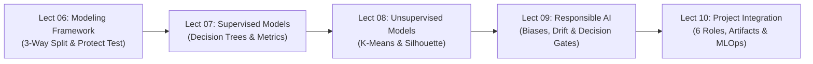
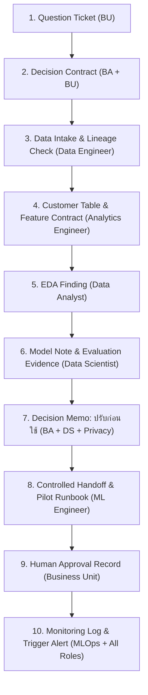
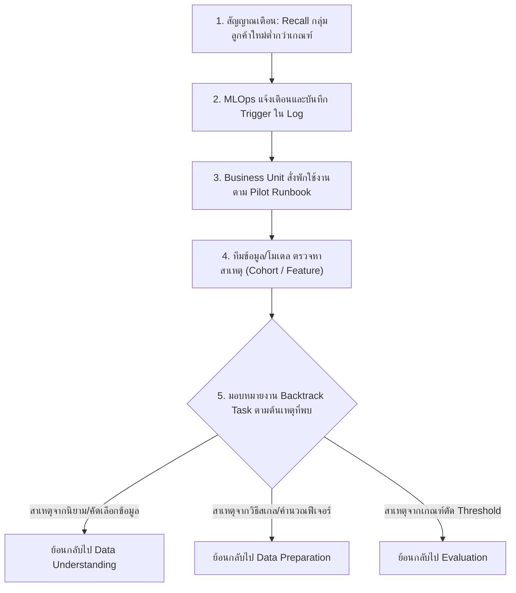

# 📘 10301351 Data Science: Master Final Exam Study Guide (Lectures 06–10)
> **Comprehensive High-Yield Synthesis & Clinical Exam Blueprint**  
> **Course:** 10301351 Data Science | **Lectures Covered:** Lect 06, Lect 07, Lect 08, Lect 09, Lect 10  
> **Framework Base:** 8-Stage CRISP-DS & Cross-Functional Data Team Governance

---

## 📑 สารบัญภาพรวม (Table of Contents)
1. [ภาพรวมกรอบความคิด & แผนที่ข้อสอบ Final (Exam Blueprint & CRISP-DS Integration)](#1-ภาพรวมกรอบความคิด--แผนที่ข้อสอบ-final)
2. [Lecture 06: Modeling Framework & ยุทธศาสตร์การแบ่งชุดข้อมูล](#2-lecture-06-modeling-framework--ยุทธศาสตร์การแบ่งชุดข้อมูล)
3. [Lecture 07: Tree-Based Models & Classifier Evaluation Metrics](#3-lecture-07-tree-based-models--classifier-evaluation-metrics)
4. [Lecture 08: Unsupervised Learning — K-Means Clustering & การประเมินกลุ่ม](#4-lecture-08-unsupervised-learning--k-means-clustering--การประเมินกลุ่ม)
5. [Lecture 09: Responsible Data Science, อคติ และจริยธรรม AI](#5-lecture-09-responsible-data-science-อคติ-และจริยธรรม-ai)
6. [Lecture 10: Project Integration, CRISP-DS in Action & 6 บทบาททีมข้อมูล](#6-lecture-10-project-integration-crisp-ds-in-action--6-บทบาททีมข้อมูล)
7. [ตารางคลังสูตรเร่งด่วน 10 นาทีก่อนเข้าห้องสอบ (Cheat Sheet Table)](#7-ตารางคลังสูตรเร่งด่วน-10-นาทีก่อนเข้าห้องสอบ)

---

# 1. ภาพรวมกรอบความคิด & แผนที่ข้อสอบ Final

การสอบปลายภาควิชา 10301351 Data Science ร้อยเรียงเนื้อหาผ่านกระบวนการ **CRISP-DS (Cross-Industry Standard Process for Data Science) 8 ขั้นตอน** โดยครึ่งหลังของวิชา (Lectures 06–10) ครอบคลุมตั้งแต่การสร้างแบบจำลองไปจนถึงการส่งมอบงานและการกำกับดูแลในโลกจริง:



### 🎯 เมทริกซ์ 10 กับดักข้อสอบยอดฮิต (Top 10 Exam Traps Matrix)
| ลำดับ | ประเด็นกับดักในข้อสอบ | ความเข้าใจผิดที่พบบ่อย | ความจริงที่ถูกต้องตามสไลด์อาจารย์ | สไลด์อ้างอิง |
|:---:|:---|:---|:---|:---:|
| 1 | **Protect the Test Set** | นำ Test Set มาจูน max_depth หรือเลือก Candidate Models | Test Set ใช้ประเมินความสามารถ Generalization **เพียงครั้งเดียวตอนสุดท้าย** ห้ามแตะต้องในขั้นตอนจูน | Lect 06 / Lect 07 p32 |
| 2 | **Splitting Criterion** | เลือกกิ่งที่ได้ Gini_split สูงที่สุด | ต้องเลือกกิ่งที่ได้ **Gini_split ต่ำสุด** ซึ่งส่งผลให้ได้ **Gini Gain สูงสุด** | Lect 07 p11–12 |
| 3 | **Tree Complexity** | ต้นไม้ที่แตกกิ่งลึกที่สุด (Unrestricted) ดีที่สุดเพราะ Train Acc = 100% | ต้นไม้ลึกเกินไปเกิด **Overfitting** (High Variance) ค่าที่เหมาะสมคือระดับกลาง (Moderate max_depth = 3) | Lect 07 p19, p31 |
| 4 | **Confusion Matrix Axes** | จำว่าแถวเป็น Predicted คอลัมน์เป็น Actual | สไลด์วิชานี้ใช้ **แถว = Actual (จริง)** และ **คอลัมน์ = Predicted (ทำนาย)** และต้องเขียน `Positive Class = ...` บรรทัดแรก | Lect 07 p22 |
| 5 | **Distance Trap in K-Means** | นำสูตร Squared Euclidean ไปใช้ตอนจัดจุดเข้ากลุ่ม | ขั้นตอน Assign จุดในสไลด์ใช้ **Manhattan Distance** ($L_1$) เพื่อคิดเลขง่าย ส่วน **Inertia/WCSS** ใช้ Squared Euclidean ($L_2^2$) | Lect 08 p25, p35 |
| 6 | **Clustering Goal** | จำสลับระหว่าง Intra กับ Inter Similarity | ต้อง **Maximize Intra-cluster Similarity** (ในกลุ่มใกล้กัน) และ **Minimize Inter-cluster Similarity** (ต่างกลุ่มห่างกัน) | Lect 08 p12 |
| 7 | **Proxy Features Bias** | คิดว่าการลบคอลัมน์เพศ/เชื้อชาติจะขจัดอคติได้สมบูรณ์ | ตัวแปรอื่นอย่าง **รหัสไปรษณีย์ (ZIP Code)** หรือประวัติค่าใช้จ่ายทำหน้าที่เป็น Proxy บ่งบอกเชื้อชาติ/ฐานะทางอ้อม | Lect 09 p13 |
| 8 | **Concept Drift** | คิดว่า Concept Drift คือค่าเฉลี่ยของ Feature เปลี่ยนแปลง | Concept Drift คือ **ความสัมพันธ์ $P(Y \mid X)$ เปลี่ยนไป** เช่น ลูกค้าไม่ซื้อ 45 วัน $\to$ 70 วัน ทำให้ Recall ตกเหลือ 54% | Lect 09 p11, p20 |
| 9 | **Decision Contract vs Memo** | สับสนว่าทั้งสองเอกสารทำในขั้นตอนเดียวกัน | **Decision Contract** ทำตอนต้นโครงการ (Stage 1: BU + BA) ส่วน **Decision Memo** ทำตอนประเมินผล (Stage 6: BA + DS + Privacy) | Lect 10 p06, p14 |
| 10 | **Subgroup Disparity** | เชื่อใจ Overall Accuracy 84% ว่าโมเดลพร้อมใช้งานทันที | Overall Accuracy 84% อาจกลบเกลื่อนปัญหา เช่น **Recall ในกลุ่มลูกค้าใหม่ต่ำเพียง 54%** ต้องสั่ง "ปรับก่อนใช้" | Lect 10 p11, p14 |

---

# 2. Lecture 06: Modeling Framework & ยุทธศาสตร์การแบ่งชุดข้อมูล

## 2.1 นิยาม Supervised vs. Unsupervised Learning
- **Supervised Learning (การเรียนรู้แบบมีผู้สอน):** ชุดข้อมูลมี Label เฉลยชัดเจน ($Y$) แบ่งออกเป็น:
  - *Classification:* ทำนายตัวแปรกลุ่ม/หมวดหมู่ (Categorical/Discrete) เช่น ลูกค้า Churn หรือไม่ (Yes/No), ผู้เล่นได้ลงแข่งหรือไม่ (Play/Not Play).
  - *Regression:* ทำนายตัวเลขต่อเนื่อง (Continuous Numerical) เช่น ยอดขาย, ราคาประเมินบ้าน, อุณหภูมิ.
- **Unsupervised Learning (การเรียนรู้แบบไม่มีผู้สอน):** ชุดข้อมูลไม่มี Label เฉลย ($Y$) โมเดลทำหน้าที่ค้นหาโครงสร้างภายใน เช่น การจัดกลุ่มลูกค้า (Clustering) หรือการลดมิติข้อมูล (Dimensionality Reduction / PCA).

## 2.2 กฎการแบ่งข้อมูล 3 ส่วน (3-Way Data Partitioning)
ในกระบวนการ Data Science มาตรฐาน การแบ่งข้อมูลแบ่งออกเป็น 3 ส่วนอิสระจากกัน:

```
┌─────────────────────────────────────────────────────────────────────────┐
│                      Total Available Dataset (100%)                     │
└────────────────────────────────────┬────────────────────────────────────┘
                                     │
         ┌───────────────────────────┴───────────────────────────┐
         ▼                                                       ▼
┌──────────────────────────────────┐            ┌──────────────────────────────────┐
│     Development Set (80–85%)     │            │      Protected Test Set (15–20%) │
└────────────────┬─────────────────┘            └──────────────────────────────────┘
                 │                                                ▲
    ┌────────────┴────────────┐                                   │
    ▼                         ▼                                   │
┌───────────────────────┐ ┌───────────────────────┐               │
│ Training Set (60–70%) │ │ Validation Set(15–20%)│               │
│ • Fit Model Parameters│ │ • Tune Hyperparameter │               │
│ • Learn Tree Splits   │ │ • Select Best Model   │               │
└───────────────────────┘ └───────────────────────┘               │
                                     │                            │
                                     └────── Final Winner ────────┘
                                           (Evaluated ONCE)
```

1. **Training Set (60% – 70%):** ใช้สอนโมเดลเรียนรู้ความสัมพันธ์ (Fit Parameters เช่น คำนวณจุดตัดกิ่ง, ค่าน้ำหนัก Weights)
2. **Validation Set (15% – 20%):** ใช้ปรับจูน Hyperparameter (เช่น กำหนด `max_depth`, ค่า `k` ใน KNN) และใช้เปรียบเทียบคัดเลือก Best Candidate Model
3. **Test Set (15% – 20%):** **"Protected Test Set"** ต้องล็อกไว้ประเมินประสิทธิภาพครั้งสุดท้ายเพียงครั้งเดียว (Final Unbiased Evaluation) เพื่อวัด Generalization Error ของโมเดลในสภาพแวดล้อมที่แท้จริง
   > [!CAUTION]
   > **กฎเหล็กห้องสอบ:** ห้ามนำ Test Set มาใช้จูนพารามิเตอร์, ห้ามใช้เลือก Candidate Model และห้ามนำไป Fit Scaler (Min-Max / Z-score) เพราะจะเกิด **Data Leakage** ทันที!

## 2.3 ตารางเปรียบเทียบ 4 ตระกูล Candidate Models (Lect 07 p33)
| ตระกูลโมเดล (Model Family) | กลไกการเรียนรู้หลัก (Learning Mechanism) | ความสามารถในการตีความ (Interpretability) | ข้อกำหนดด้าน Feature Scaling | จุดเด่น & ความเสี่ยงสำคัญ |
|:---|:---|:---:|:---:|:---|
| **1. Decision Tree** | แตกกิ่งตามเงื่อนไข If-Else เพื่อลดค่าความไม่บริสุทธิ์ (Gini / Entropy) | **สูงมาก (White-box)** | ไม่จำเป็นต้องทำ | เข้าใจง่าย ไม่ไวต่อ Outlier บน Feature เดี่ยว แต่เสี่ยง Overfitting สูง |
| **2. 5-NN (K-Nearest Neighbors)** | คำนวณระยะห่าง (Distance) และโหวตคลาสตามเพื่อนบ้านใกล้สุด $k=5$ จุด | ปานกลาง (Instance-based) | **จำเป็นอย่างยิ่ง!** (Min-Max/Z-Score) | ไวต่อสเกลตัวแปรมาก หากไม่สเกล ตัวแปรที่มีค่ามากจะครอบงำระยะห่างทั้งหมด |
| **3. Naive Bayes** | คำนวณความน่าจะเป็นแบบมีเงื่อนไขตามทฤษฎีเบย์ $P(Y \mid X)$ | สูง (ดูสัดส่วนความน่าจะเป็น) | ไม่จำเป็น | คำนวณรวดเร็ว แต่ตั้งสมมติฐานว่าทุกฟีเจอร์เป็นอิสระต่อกัน (Conditional Independence) |
| **4. Neural Network** | ส่งสัญญาณผ่านหลายชั้น (Hidden Layers) ปรับค่าน้ำหนักผ่าน Backpropagation | **ต่ำมาก (Black-box)** | **จำเป็นอย่างยิ่ง!** | จับความสัมพันธ์ซับซ้อนแบบ Non-linear ได้ดีมาก แต่ต้องใช้ข้อมูลมหาศาลและเสี่ยง Overfit |

---

# 3. Lecture 07: Tree-Based Models & Classifier Evaluation Metrics

## 3.1 คณิตศาสตร์ของ Decision Tree: Gini Impurity, Split & Gain
Decision Tree ในสไลด์วิชานี้ใช้ **Gini Index (Gini Impurity)** เป็นเกณฑ์หลักในการคัดเลือก Feature และจุดตัดกิ่ง (Splitting Criterion):

### 1. Gini Impurity ของโหนดเดี่ยว (Single Node)
$$\text{Gini}(t) = 1 - \sum_{i=1}^{C} (p_i)^2$$
- โดยที่ $p_i$ คือสัดส่วนของตัวอย่างในคลาส $i$ ต่อจำนวนตัวอย่างทั้งหมดในโหนดนั้น
- **ขอบเขตสำหรับ Binary Classification ($C=2$):**
  - $\text{Gini} = 0.000$ $\implies$ **Pure Node** (โหนดบริสุทธิ์ มีสมาชิกคลาสเดียว 100%)
  - $\text{Gini} = 0.500$ $\implies$ **Maximum Impurity** (ข้อมูลปนกันอย่างละครึ่ง 50:50)

### 2. Weighted Gini Split (ความไม่บริสุทธิ์รวมหลังแบ่งกิ่ง)
$$\text{Gini}_{\text{split}} = \left(\frac{n_L}{N}\right) \text{Gini}(L) + \left(\frac{n_R}{N}\right) \text{Gini}(R)$$
- $n_L, n_R$ คือจำนวนตัวอย่างในโหนดลูกฝั่งซ้ายและขวาตามลำดับ ($N = n_L + n_R$)

### 3. Gini Gain (ค่าการลดความไม่บริสุทธิ์)
$$\text{Gain} = \text{Gini}(\text{Parent}) - \text{Gini}_{\text{split}}$$
- **เกณฑ์การตัดสินใจ:** เลือก Feature หรือจุดตัดกิ่งที่ให้ **$\text{Gini}_{\text{split}}$ ต่ำที่สุด** ซึ่งจะทำให้ได้ **$\text{Gain}$ สูงที่สุด** เสมอ!

---

### 🧮 ตัวอย่างคำนวณจริงจากสไลด์ (Lect 07 p11–12)
- **Parent Node:** ข้อมูลรวม $N = 12$ ราย (คลาส Play = 6, Not Play = 6)
  $$\text{Gini}(\text{Parent}) = 1 - \left[\left(\frac{6}{12}\right)^2 + \left(\frac{6}{12}\right)^2\right] = 1 - (0.25 + 0.25) = 0.500$$

- **เปรียบเทียบระหว่าง Candidate Split A และ Candidate Split B:**
  - **Candidate Split A:**
    - โหนดซ้าย ($n_L = 6$): [5 Play, 1 Not Play] $\implies \text{Gini}(L) = 1 - \left[\left(\frac{5}{6}\right)^2 + \left(\frac{1}{6}\right)^2\right] = 1 - \left(\frac{25}{36} + \frac{1}{36}\right) = \frac{10}{36} \approx 0.278$
    - โหนดขวา ($n_R = 6$): [1 Play, 5 Not Play] $\implies \text{Gini}(R) = 1 - \left[\left(\frac{1}{6}\right)^2 + \left(\frac{5}{6}\right)^2\right] = \frac{10}{36} \approx 0.278$
    - $\text{Gini}_{\text{split}}(A) = \left(\frac{6}{12}\right)(0.278) + \left(\frac{6}{12}\right)(0.278) = 0.278$
    - $\text{Gini Gain}(A) = 0.500 - 0.278 = \mathbf{0.222}$
  - **Candidate Split B:**
    - โหนดซ้าย ($n_L = 6$): [4 Play, 2 Not Play] $\implies \text{Gini}(L) = 1 - \left[\left(\frac{4}{6}\right)^2 + \left(\frac{2}{6}\right)^2\right] = 1 - \left(\frac{16}{36} + \frac{4}{36}\right) = \frac{16}{36} \approx 0.444$
    - โหนดขวา ($n_R = 6$): [2 Play, 4 Not Play] $\implies \text{Gini}(R) = \frac{16}{36} \approx 0.444$
    - $\text{Gini}_{\text{split}}(B) = \left(\frac{6}{12}\right)(0.444) + \left(\frac{6}{12}\right)(0.444) = 0.444$
    - $\text{Gini Gain}(B) = 0.500 - 0.444 = \mathbf{0.056}$
  - **บทสรุปในห้องสอบ:** เลือก **Candidate Split A** เพราะลดความไม่บริสุทธิ์ได้มากกว่า ($\text{Gain } 0.222 > 0.056$)

---

## 3.2 บันไดความซับซ้อนของต้นไม้ & Bias-Variance Tradeoff (Lect 07 p19, p31)
| ระดับความลึก (Tree Depth) | ระดับ Bias (ความเอนเอียง) | ระดับ Variance (ความแปรปรวน) | ปรากฏการณ์ที่เกิดขึ้น | ผลการทดสอบบน Validation Set |
|:---|:---:|:---:|:---|:---:|
| **Shallow Tree** (`max_depth = 1`) | **สูง (High Bias)** | ต่ำ (Low Variance) | **Underfitting** (ต้นไม้ตื้นเกินไป จับกฎไม่พอ) | ต่ำทั้ง Train และ Validation |
| **Moderate Tree** (`max_depth = 3`) | **ต่ำกำลังดี** | **ต่ำกำลังดี** | **Appropriate Fit** (จุดสมดุลที่ดีที่สุด) | **Validation สูงสุด (Selected!)** |
| **Deep Tree** (`max_depth >= 6`) | ต่ำมาก | **สูงมาก (High Variance)** | **Overfitting** (เริ่มจดจำ Noise ในชุด Train) | Train สูง แต่ Validation เริ่มลดฮวบ |
| **Unrestricted Tree** (ไม่จำกัดความลึก) | ต่ำที่สุด ($\approx 0$) | **สูงที่สุด (Extreme)** | **Extreme Overfitting** (จำข้อสอบได้ 100%) | Train 100% แต่ Validation ตกต่ำอย่างรุนแรง |

> [!TIP]
> **วิธีแก้ Overfitting ใน Decision Tree:**
> 1. **Pre-pruning (ตัดกิ่งล่วงหน้า):** กำหนด `max_depth = 3`, `min_samples_split`, `min_samples_leaf`
> 2. **Post-pruning (ตัดแต่งกิ่งย้อนหลัง):** ปล่อยให้โตเต็มที่แล้วตัดกิ่งที่ไม่ช่วยเพิ่มคะแนนบน Validation ทิ้ง
> 3. **Ensemble Methods:** รวมพลังหลายต้นไม้ เช่น Random Forest (Bagging) หรือ Gradient Boosting (Boosting)

---

## 3.3 โครงสร้าง Confusion Matrix & เมตริกวัดผล 4 ชนิด
ตามแบบจำลองในสไลด์อาจารย์ (Lect 07 p22): **แนวนอน (Rows) = Actual Class**, **แนวตั้ง (Columns) = Predicted Class**

```
                         Predicted Class (ผลทำนาย)
                      ┌──────────────┬──────────────┐
                      │ Positive (+) │ Negative (-) │
       ┌──────────────┼──────────────┼──────────────┤
Actual │ Positive (+) │      TP      │      FN      │  <-- ผลรวมแถว = Actual Positives
Class  │              │ (Hit/แม่นยำ) │(Type II Miss)│
(จริง) ├──────────────┼──────────────┼──────────────┤
       │ Negative (-) │      FP      │      TN      │  <-- ผลรวมแถว = Actual Negatives
       │              │(Type I Alarm)│(Correct Rej) │
       └──────────────┴──────────────┴──────────────┘
                             ▲              ▲
                       ผลรวมคอลัมน์    ผลรวมคอลัมน์
                       = Pred Pos     = Pred Neg
```

### สูตรและนัยสำคัญทางธุรกิจ
1. **Accuracy (ความถูกต้องรวม):**
   $$\text{Accuracy} = \frac{\text{TP} + \text{TN}}{\text{TP} + \text{TN} + \text{FP} + \text{FN}}$$
   - *ข้อควรระวัง:* ใช้ได้ดีเฉพาะเมื่อข้อมูลสมดุล (Balanced Classes) หากเจอ Imbalanced Data ค่านี้จะหลอกตา

2. **Precision (ความแม่นยำของผลบวก):**
   $$\text{Precision} = \frac{\text{TP}}{\text{TP} + \text{FP}}$$
   - *คำถามที่ตอบ:* ในบรรดาคนที่โมเดลชี้หน้าว่าบวก เป็นของจริงกี่เปอร์เซ็นต์?
   - *โฟกัส:* **ต้องการลด False Positive (FP)** ให้เหลือน้อยที่สุด เหมาะกับงานที่มีต้นทุนการทายผิดบวกสูง เช่น การบล็อกอีเมลสำคัญ (Spam Filtering) หรือการแจกคูปองส่วนลดราคาแพงมาก

3. **Recall / Sensitivity (อัตราการครอบคลุมของจริง):**
   $$\text{Recall} = \frac{\text{TP}}{\text{TP} + \text{FN}}$$
   - *คำถามที่ตอบ:* จากของจริงทั้งหมดที่เป็นบวก โมเดลตามจับได้กี่เปอร์เซ็นต์?
   - *โฟกัส:* **ต้องการลด False Negative (FN)** ให้เหลือน้อยที่สุด เหมาะกับงานที่การหลุดรอดสร้างความเสียหายร้ายแรง เช่น การตรวจคัดกรองโรคมะเร็ง, การตรวจจับทุจริตธุรกรรมการเงิน, หรือการดักจับลูกค้ากำลังจะย้ายค่าย (Churn Prevention)

4. **F1-Score (ค่าเฉลี่ยฮาร์โมนิก):**
   $$\text{F1-Score} = 2 \times \frac{\text{Precision} \times \text{Recall}}{\text{Precision} + \text{Recall}} = \frac{2\text{TP}}{2\text{TP} + \text{FP} + \text{FN}}$$
   - *โฟกัส:* ใช้ประเมินเมื่อต้องการความสมดุลระหว่าง Precision และ Recall โดยค่าเฉลี่ยฮาร์โมนิกจะลงโทษโมเดลที่มีค่าใดค่าหนึ่งต่ำผิดปกติอย่างรุนแรง

---

## 3.4 รวมโจทย์คำนวณจริงจากสไลด์และการบ้าน (Official Cases)

### 📌 Case 1: FIFA World Cup 2026 Prediction (Lect 07 p23, p27)
- **นิยาม:** $N = 10$, $\text{Positive Class} = \text{Play}$
- **ตารางผล:** $\text{TP} = 4, \text{FN} = 2, \text{FP} = 1, \text{TN} = 3$
  - $\text{Accuracy} = \frac{4 + 3}{10} = \mathbf{0.70}$
  - $\text{Precision} = \frac{4}{4 + 1} = \frac{4}{5} = \mathbf{0.80}$
  - $\text{Recall} = \frac{4}{4 + 2} = \frac{4}{6} \approx \mathbf{0.67}$
  - $\text{F1-Score} = \frac{2(4)}{2(4) + 1 + 2} = \frac{8}{11} \approx \mathbf{0.73}$

### 📌 Case 2: HW#1 Customer Churn (10 Records - Lect 07 p28)
- **นิยาม:** $N = 10$, $\text{Positive Class} = \text{Inactive}$
- **ตารางผล:** $\text{TP} = 3, \text{FN} = 2, \text{FP} = 2, \text{TN} = 3$
  - $\text{Accuracy} = \frac{3 + 3}{10} = \mathbf{0.60}$
  - $\text{Precision} = \frac{3}{3 + 2} = \mathbf{0.60}$
  - $\text{Recall} = \frac{3}{3 + 2} = \mathbf{0.60}$
  - $\text{F1-Score} = \mathbf{0.60}$
  > [!NOTE]
  > ข้อสังเกตในห้องสอบ: เมื่อ $\text{TP} = \text{TN}$ และ $\text{FP} = \text{FN}$ ค่าทั้ง 4 เมตริกจะเท่ากันพอดี!

### 📌 Case 3: HW#2 Model Selection Trade-off (100 Records - Lect 07 p35)
การตัดสินใจเลือกโมเดลทำนายลูกค้าไม่เคลื่อนไหว ($N = 100$, Actual Inactive = 40, Active = 60):
| เมตริก / คุณลักษณะ | Model A (Conservative) | Model B (Aggressive) | Model C (Balanced Winner) |
|:---|:---:|:---:|:---:|
| **Confusion Matrix** | $\text{TP}=24, \text{FN}=16$<br/>$\text{FP}=3, \text{TN}=57$ | $\text{TP}=36, \text{FN}=4$<br/>$\text{FP}=18, \text{TN}=42$ | $\text{TP}=32, \text{FN}=8$<br/>$\text{FP}=7, \text{TN}=53$ |
| **Accuracy** | $81 / 100 = 0.81$ | $78 / 100 = 0.78$ | $\mathbf{85 / 100 = 0.85}$ (สูงสุด) |
| **Precision** | $\mathbf{24 / 27 \approx 0.89}$ (สูงสุด) | $36 / 54 \approx 0.67$ | $32 / 39 \approx 0.82$ |
| **Recall** | $24 / 40 = 0.60$ | $\mathbf{36 / 40 = 0.90}$ (สูงสุด) | $32 / 40 = 0.80$ |
| **F1-Score** | $0.72$ | $0.77$ | $\mathbf{0.81}$ (สูงสุด) |
| **บริบทธุรกิจที่ควรเลือก** | เมื่อ **ต้นทุนติดต่อลูกค้าแพงมาก** ไม่ต้องการเสียเงินกับลูกค้าที่ไม่คิดจะหนี (ลด FP) | เมื่อ **ต้นทุนการเสียลูกค้าสูงลิ่ว** (Missed Churn Cost ร้ายแรง) ยอมเสียค่าโทรหาคนฟรี 18 ราย เพื่อจับลูกค้าหนีให้ได้ 90% | **ทางเลือกที่ดีที่สุดในภาพรวม** เพราะได้ F1 สูงสุด (0.81) และ Accuracy สูงสุด (0.85) ชนะ Model A ทุกมิติ |

---

# 4. Lecture 08: Unsupervised Learning — K-Means Clustering & การประเมินกลุ่ม

## 4.1 เป้าหมายและระยะทางใน K-Means
- **เป้าหมายหลัก:**
  1. **Maximize Intra-Cluster Similarity:** ความคล้ายคลึงภายในกลุ่มเดียวกันสูงที่สุด (สมาชิกเกาะกลุ่มชิดกันแน่นที่สุด)
  2. **Minimize Inter-Cluster Similarity:** ความคล้ายคลึงระหว่างกลุ่มต่ำที่สุด (แต่ละกลุ่มอยู่ห่างออกจากกันมากที่สุด)

- **สูตรระยะทาง (Distance Metrics):**
  - **Manhattan Distance ($L_1$ Norm):**
    $$d(X, Y) = |x_1 - y_1| + |x_2 - y_2| + \dots + |x_p - y_p|$$
    *(ใช้ในขั้นตอนคำนวณมือเพื่อจัดจุดเข้ากลุ่มในสไลด์อาจารย์)*
  - **Euclidean Distance ($L_2$ Norm):**
    $$d(X, Y) = \sqrt{\sum_{i=1}^{p} (x_i - y_i)^2}$$

---

## 4.2 ตัวอย่างโจทย์คำนวณจริง 8 จุด ($A_1 \dots A_8$) จบรอบที่ 1 (Lect 08 p25–28)
- **จุดข้อมูล 8 จุด:** $A_1(2,10), A_2(2,5), A_3(8,4), A_4(5,8), A_5(7,5), A_6(6,4), A_7(1,2), A_8(4,9)$
- **จุดศูนย์กลางเริ่มต้น (Initial Centroids):** $C_1(2,10), C_2(5,8), C_3(1,2)$
- **การจัดสรรจุดเข้ากลุ่มด้วย Manhattan Distance ($|x_1 - c_1| + |x_2 - c_2|$):**
  - $A_1(2,10) \implies d(C_1)=0, d(C_2)=5, d(C_3)=9 \implies \mathbf{Cluster\ 1}$
  - $A_2(2,5) \implies d(C_1)=5, d(C_2)=6, d(C_3)=4 \implies \mathbf{Cluster\ 3}$
  - $A_3(8,4) \implies d(C_1)=12, d(C_2)=7, d(C_3)=9 \implies \mathbf{Cluster\ 2}$
  - $A_4(5,8) \implies d(C_1)=5, d(C_2)=0, d(C_3)=10 \implies \mathbf{Cluster\ 2}$
  - $A_5(7,5) \implies d(C_1)=10, d(C_2)=5, d(C_3)=9 \implies \mathbf{Cluster\ 2}$
  - $A_6(6,4) \implies d(C_1)=10, d(C_2)=5, d(C_3)=7 \implies \mathbf{Cluster\ 2}$
  - $A_7(1,2) \implies d(C_1)=9, d(C_2)=10, d(C_3)=0 \implies \mathbf{Cluster\ 3}$
  - $A_8(4,9) \implies d(C_1)=3, d(C_2)=2, d(C_3)=10 \implies \mathbf{Cluster\ 2}$

- **สรุปสมาชิกในคลัสเตอร์:**
  - $\text{Cluster 1} = \{A_1\}$ (1 จุด)
  - $\text{Cluster 2} = \{A_3, A_4, A_5, A_6, A_8\}$ (5 จุด)
  - $\text{Cluster 3} = \{A_2, A_7\}$ (2 จุด)

- **การคำนวณจุดศูนย์กลางใหม่รอบถัดไป (New Centroids):**
  - $C_1^{\text{new}} = A_1 = \mathbf{(2, 10)}$
  - $C_2^{\text{new}} = \left(\frac{8+5+7+6+4}{5}, \frac{4+8+5+4+9}{5}\right) = \left(\frac{30}{5}, \frac{30}{5}\right) = \mathbf{(6, 6)}$
  - $C_3^{\text{new}} = \left(\frac{2+1}{2}, \frac{5+2}{2}\right) = \left(\frac{3}{2}, \frac{7}{2}\right) = \mathbf{(1.5, 3.5)}$

---

## 4.3 เครื่องมือประเมินคุณภาพ Cluster: Inertia & Silhouette Score

### 1. Inertia / WCSS (Within-Cluster Sum of Squares)
$$\text{Inertia} = \sum_{k=1}^{K} \sum_{x \in C_k} \|x - C_k\|^2$$
- วัดความแน่น (Compactness) ภายในกลุ่ม โดยใช้ **Squared Euclidean Distance**
- ยิ่งค่า Inertia ต่ำ แปลว่าสมาชิกในกลุ่มเกาะกลุ่มกันแน่นชิด
- เมื่อเพิ่มจำนวนกลุ่ม $k$ ค่า Inertia จะลดลงเสมอ จึงต้องใช้ **Elbow Method** เลือกค่า $k$ ณ ตำแหน่ง "ข้อศอก" ที่อัตราการลดลงเริ่มชะลอตัว

### 2. Silhouette Score ($s(i)$)
$$s(i) = \frac{b(i) - a(i)}{\max(a(i), b(i))}$$
- $a(i)$ = ระยะทางเฉลี่ยจากจุด $i$ ไปยังจุดอื่น ๆ ภายในคลัสเตอร์เดียวกัน (**Intra-cluster distance** — ยิ่งน้อยยิ่งดี)
- $b(i)$ = ระยะทางเฉลี่ยจากจุด $i$ ไปยังจุดในคลัสเตอร์เพื่อนบ้านที่ใกล้ที่สุด (**Inter-cluster distance** — ยิ่งมากยิ่งดี)
- **การแปลผลช่วงคะแนน $[-1, +1]$ ในห้องสอบ:**
  - **ใกล้ $+1$ ($s(i) \to 1$):** จุดข้อมูลจัดกลุ่มได้อย่างสมบูรณ์แบบ ($a(i) \ll b(i)$)
  - **ใกล้ $0$ ($s(i) \to 0$):** จุดข้อมูลอยู่บริเวณขอบรอยต่อระหว่าง 2 คลัสเตอร์ (Borderline)
  - **ติดลบ ($s(i) < 0$):** จุดข้อมูลอยู่ผิดกลุ่ม! อยู่ใกล้คลัสเตอร์ข้างเคียงมากกว่ากลุ่มตัวเอง

---

# 5. Lecture 09: Responsible Data Science, อคติ และจริยธรรม AI

## 5.1 อคติ 3 ประการ (3 Sources of Bias in AI)
1. **Historical Bias (อคติจากประวัติศาสตร์):** ข้อมูลในอดีตสะท้อนความเหลื่อมล้ำทางสังคมหรือนโยบายเดิม
   - *ตัวอย่างสไลด์ (p10):* ในอดีตบริษัทเคยส่งโปรโมชันให้เฉพาะกลุ่ม VIP ทำให้อัตราตอบรับของ VIP = 80% ส่วน Non-VIP = 20% โมเดลจึงเรียนรู้ผิดๆ ว่ากลุ่ม Non-VIP ไม่คุ้มค่าที่จะทำการตลาด
2. **Representation Bias (อคติจากการคัดเลือกกลุ่มตัวอย่าง):** ข้อมูลที่เก็บมาไม่เป็นตัวแทนประชากรจริง
   - *ตัวอย่างสไลด์ (p10):* กลุ่มลูกค้าสมาชิกถูกเก็บข้อมูลมาถึง 800 ราย แต่กลุ่มลูกค้าทั่วไปมีข้อมูลเพียง 40 ราย ทำให้โมเดลมองไม่เห็นรูปแบบของลูกค้าทั่วไป
3. **Proxy Feature Bias (อคติจากตัวแปรตัวแทน):** แม้ตัดตัวแปรอ่อนไหวออก แต่ตัวแปรอื่นทำหน้าที่แทน
   - *ตัวอย่างสไลด์ (p13):* การลบคอลัมน์ "เชื้อชาติ" หรือ "เพศ" ไม่ได้ช่วยแก้ปัญหา เพราะ "รหัสไปรษณีย์ (ZIP Code)" สะท้อนเขตที่อยู่อาศัย ฐานะ และเชื้อชาติได้เช่นกัน

## 5.2 Concept Drift vs. Data Drift
- **Concept Drift:** ความสัมพันธ์ระหว่าง Feature และ Target $P(Y \mid X)$ เปลี่ยนแปลงไปตามกาลเวลา
  - *เคสจริงในสไลด์ (p11, p20):* ในอดีตนิยาม Inactive คือ "ไม่ซื้อสินค้านานเกิน 45 วัน" แต่ต่อมาพฤติกรรมลูกค้าเปลี่ยนเป็น "70 วัน" หากไม่ปรับโมเดล โมเดลเดิมจะทำนายผิดพลาดรุนแรงและทำให้ **Recall ลดลงเหลือ 54%**
- **Data Drift:** การกระจายตัวของตัวแปรต้น $P(X)$ เปลี่ยนแปลงไป แต่ความสัมพันธ์กับ Target ยังคงเดิม

## 5.3 Explainable AI (XAI) & SHAP Force Plot
- **Global Explanation:** อธิบายพฤติกรรมภาพรวมของโมเดลทั้งระบบ เช่น Feature Importance
- **Local Explanation:** อธิบายการตัดสินใจรายบุคคล เช่น **SHAP Force Plot**:
  - เริ่มต้นจากค่าพื้นฐาน **Base Value** $E[f(x)]$ (ค่าเฉลี่ยคำทำนายของประชากร)
  - ตัวแปรที่มีแรงผลักบวก (+SHAP สีแดง/เขียว) จะดันผลลัพธ์ให้สูงขึ้น
  - ตัวแปรที่มีแรงผลักลบ (−SHAP สีน้ำเงิน/แดง) จะฉุดผลลัพธ์ให้ต่ำลง จนได้คำทำนายสุทธิ $f(x)$

## 5.4 สรุป 4 คดีประวัติศาสตร์ด้านกฎหมายและ AI (Legal Cases Summary)
| องค์กร / คดี (ปี) | ข้อผิดพลาดของระบบ AI | กฎหมายที่ละเมิด / บทลงโทษในสไลด์ | นัยสำคัญสำหรับนักวิทยาศาสตร์ข้อมูล |
|:---|:---|:---|:---|
| **1. iTutorGroup (EEOC, 2023)** | ตั้งระบบคัดกรองใบสมัครงานอัตโนมัติ โดยปฏิเสธผู้หญิงอายุ $>55$ ปี และผู้ชายอายุ $>60$ ปี ทันที | ละเมิด ADEA คัดผู้สมัครตกไปกว่า 200 ราย ถูกสั่งปรับเงิน **\$365,000** | ห้ามใช้ตัวแปรอายุหรือตั้งกฎตัดสิทธิ์อัตโนมัติ |
| **2. Health-risk Algorithm (2019)** | ใช้ "ค่ารักษาพยาบาลในอดีต" เป็น Proxy แทนความรุนแรงของโรค คนผิวดำยากจนกว่าจึงใช้จ่ายน้อยและถูกมองว่าไม่ป่วย | หลังแก้ไขตัวแปรเป้าหมาย สัดส่วนคนไข้ผิวดำที่ได้รับการดูแลเพิ่มจาก **17.7% เป็น 46.5%** | การเลือก Target Variable ที่ผิดพลาดสร้างความเหลื่อมล้ำรุนแรง |
| **3. Meta Housing Ads (DOJ, 2022)** | อัลกอริทึมเลือกกลุ่มคนเห็นโฆษณาบ้านตามเพศและเชื้อชาติ | ละเมิด Fair Housing Act ถูกปรับ **\$115,054** และบังคับสร้าง Variance Reduction System (VRS) | อัลกอริทึม Ad Delivery ต้องมีกลไกตรวจสอบความเป็นธรรม |
| **4. Rite Aid (FTC, 2023–2024)** | ใช้ Facial Recognition จับขโมย แต่เกิด False Positive สูง ชี้ตัวลูกค้าผู้บริสุทธิ์ผิด | FTC สั่ง **แบนการใช้ Facial Recognition 5 ปี** และบังคับให้ต้องมี Human Checkpoint | ห้ามปล่อยให้ AI ตัดสินใจส่งผลกระทบต่อสิทธิเสรีภาพโดยไม่มีคนคุม |

---

# 6. Lecture 10: Project Integration, CRISP-DS in Action & 6 บทบาททีมข้อมูล

Lecture 10 เป็นการผสานศาสตร์ทั้งหมดเข้ากับการทำงานจริงในองค์กร โดยเปลี่ยนจากมุมมอง **"นักเขียนโค้ดเดี่ยว"** ไปสู่ **"ห่วงโซ่ความรับผิดชอบข้ามสายงาน (Cross-Functional Accountability Chain)"**:

```
Problem ──▶ Data ──▶ Insight ──▶ Decision ──▶ Value
```

## 6.1 กรอบการทำงาน 8 ขั้นตอนของ CRISP-DS ยุคใหม่
1. **Business Understanding (ทำความเข้าใจเป้าหมายทางธุรกิจ):** แปลงโจทย์ปัญหาธุรกิจเป็นคำถามวิทยาศาสตร์ข้อมูล ตกลง Decision Maker, ทางเลือก และเกณฑ์ตัดสิน
2. **Data Understanding (ทำความเข้าใจข้อมูล):** สำรวจแหล่งข้อมูล ตรวจสอบความถูกต้องของ Key, สิทธิ์การใช้ข้อมูล (PDPA/Consent) และความสมบูรณ์เชิงเวลา
3. **Data Preparation (เตรียมข้อมูล):** จัดทำตาราง Features กำหนดกรอบเวลา (Point-in-time) เพื่อป้องกัน Data Leakage
4. **Exploratory Data Analysis - EDA (วิเคราะห์ข้อมูลเบื้องต้น):** หาการกระจายตัว ตรวจสอบสมมติฐาน และสรุปข้อจำกัดของข้อมูล (ไม่ใช่แค่การพล็อตกราฟ)
5. **Modeling (สร้างแบบจำลอง):** ฝึกสอน Candidate Models เปรียบเทียบทั้งเชิงทำนาย (Predictive) และเชิงอธิบาย (Explanatory)
6. **Evaluation (ประเมินผล):** วัดประสิทธิภาพเชิงสถิติควบคู่กับความเป็นธรรมรายกลุ่มย่อย (Subgroup Disparity) สรุปความคุ้มค่าและความเสี่ยง
7. **Deployment & Communication (นำไปใช้งานและสื่อสารผล):** วางระบบ Controlled Handoff, สร้าง Pilot Runbook, ตั้งระบบป้องกัน (Circuit Breaker) และอนุมัติโดยมนุษย์
8. **AI-assisted Improvement (ปรับปรุงอย่างต่อเนื่องด้วย AI ช่วย):** ติดตามประสิทธิภาพผ่าน Monitoring Contract และมีกลไก Backtrack ย้อนกลับเมื่อเกิดสิ่งผิดปกติ

---

## 6.2 6 บทบาทในทีมข้อมูลยุคใหม่ (6 Modern Data Team Roles & Tech Stacks)
| บทบาท (Role) | ภารกิจหลัก (Core Mission) | เครื่องมือและเทคโนโลยี (Tech Stack) | หลักฐานที่ส่งมอบ (Artifacts) |
|:---|:---|:---|:---|
| **1. Data Engineer** | วางรากฐาน Pipeline และ Platform ดึงข้อมูล ตรวจสอบคุณภาพ Lineage และความปลอดภัย | Apache Airflow, dbt, Apache Spark, Kafka, AWS S3 / GCP | `Data Intake & Lineage Check` |
| **2. Analytics Engineer** | จัดการ Data Modeling, Data Mart, ออกแบบตาราง Feature ให้พร้อมวิเคราะห์ คุม Point-in-time | SQL, Snowflake, BigQuery, dbt, Databricks | `Customer Table & Feature Contract` |
| **3. Data Analyst** | สำรวจและค้นหา Insight, วิเคราะห์สาเหตุ (Diagnostic), สรุปแนวโน้มและข้อจำกัดข้อมูล | Tableau, Power BI, SQL, Excel, Python (Pandas) | `EDA Finding` (ไม่ใช่แค่ชาร์ต) |
| **4. Data Scientist** | ทดสอบสมมติฐาน สร้างโมเดล ML (Decision Tree, K-Means) ประเมินผลแยกกลุ่มย่อย | Python, scikit-learn, XGBoost, PyTorch, Jupyter | `Model Note & Evaluation Evidence` |
| **5. ML Engineer / MLOps** | นำโมเดลขึ้น Production, ทำ CI/CD, Containerization, ระบบเฝ้าระวัง และระบบตัดไฟฉุกเฉิน | Docker, Kubernetes, FastAPI, MLflow, Prometheus | `Controlled Handoff, Pilot Runbook & Monitoring Log` |
| **6. AI Engineer** | พัฒนาระบบประยุกต์ใช้ AI ขั้นสูง เช่น LLMs, RAG, AI Assistants สำหรับร่างเอกสาร | LangChain, LlamaIndex, Hugging Face, vLLM, Vector DB | `AI Assistant Drafts & Alert Agents` |

---

## 6.3 ห่วงโซ่ส่งมอบ Artifacts 9 ขั้นตอน (Artifact Handoff Chain)
สไลด์หน้า 5 แสดงเส้นทางการส่งต่องานจริงตั้งแต่คำถามธุรกิจจนถึงการมอนิเตอร์:



### รายละเอียดหลักฐานสำคัญ 3 ฉบับ (Crucial Contracts)
1. **Decision Contract (สัญญาการตัดสินใจ — เริ่มต้นโครงการ):**
   - *ผู้รับผิดชอบ:* BA ร่วมกับ Business Unit (AI ช่วยร่างได้ แต่คนตรวจและเซ็นอนุมัติ)
   - *องค์ประกอบ:* ผู้มีอำนาจตัดสินใจ, ทางเลือกที่มี, ขอบเขตกลุ่มเป้าหมาย, เกณฑ์ตัวชี้วัดความสำเร็จ (Metric Threshold)
2. **Feature Contract & Temporal Correctness (สัญญาฟีเจอร์ — ป้องกัน Data Leakage):**
   - *ผู้รับผิดชอบ:* Analytics Engineer
   - *กฎเหล็ก Point-in-time:* ค่าของ Feature ทุกตัวต้องเกิดขึ้น **ก่อนช่วงเวลาการตัดสินใจ ($T < T_0$)** ห้ามนำข้อมูลในอนาคตหลัง $T_0$ มาคำนวณเป็น Feature เด็ดขาด
3. **Decision Memo (บันทึกการตัดสินใจ — ขั้นตอนประเมินผล):**
   - *ผู้รับผิดชอบ:* BA + Data Scientist + Privacy Officer
   - *ผลการตัดสินใจ 3 ประตู:* **Accept** (อนุมัติใช้งาน) / **Revise** (ปรับก่อนใช้) / **Reject** (ระงับโครงการ)
   - *เคสในสไลด์หน้า 14:* สรุปผลเป็น **"ปรับก่อนใช้" (Conditional Rollout)** เนื่องจากพบปัญหา Recall ในกลุ่มลูกค้าใหม่ต่ำเพียง 54% และมีความเสี่ยงเรื่อง Concept Drift

---

## 6.4 Analytics Continuum: ระดับความลึกของการวิเคราะห์ข้อมูล
สไลด์หน้า 12 แบ่งลำดับชั้นของการวิเคราะห์ตามคุณค่าและความซับซ้อน:
1. **Descriptive Analytics (เกิดอะไรขึ้น?):** สรุปอดีตผ่าน Dashboard และ KPI เช่น อัตราลูกค้าที่ไม่ซื้อซ้ำ
2. **Diagnostic Analytics (ทำไมจึงเกิด?):** ค้นหาสาเหตุผ่าน EDA และ Drill-down Analysis
3. **Predictive Analytics (จะเกิดอะไรขึ้นต่อไป?):** คาดการณ์อนาคตด้วยโมเดล ML เช่น Decision Tree ทำนายว่าใครเสี่ยงเป็น Inactive
4. **Prescriptive Analytics (ควรทำอย่างไรเพื่อให้ได้ผลลัพธ์ที่ดีที่สุด?):** แนะนำแผนการกระทำที่เหมาะสมที่สุดโดยคำนึงถึงเงื่อนไขและข้อจำกัด
5. **AI-assisted:** การนำ Generative AI มาช่วยร่าง สรุป และแจ้งเตือน แต่ต้องอยู่ภายใต้การกำกับของมนุษย์

> [!IMPORTANT]
> **ข้อสอบชอบถาม:** "การใช้ Decision Tree ทายลูกค้า Inactive และใช้ K-Means แบ่งกลุ่ม ถือว่าเพียงพอในการยืนยันความคุ้มค่าของการติดต่อลูกค้าหรือไม่?"  
> **คำตอบ:** **ยังไม่เพียงพอ!** เพราะทั้ง Decision Tree และ K-Means บอกได้เพียง *ใครเสี่ยง* และ *กลุ่มต่างกันอย่างไร* แต่ยังไม่พิสูจน์ผลลัพธ์เชิงเหตุและผล (Causality) ว่าการติดต่อจะทำให้ลูกค้ากลับมาซื้อจริงหรือไม่ ต้องอาศัย Prescriptive / A-B Testing ในขั้นตอน Pilot

---

## 6.5 กับดัก Subgroup Metric Disparity (84% vs 54%)
- **ปัญหาภาพลวงตา (Slide 11 & 14):**
  - ผลประเมินโมเดลในภาพรวม: **Overall Accuracy = 84%**, **Overall Recall = 78%** ดูเหมือนผ่านเกณฑ์
  - เมื่อเจาะลึกรายกลุ่มย่อย (Cohort Analysis): **Recall ในกลุ่ม "ลูกค้าใหม่" (New Customers) ลดฮวบเหลือเพียง 54%!**
  - **บทเรียนในห้องสอบ:** ห้ามตัดสินใจบนค่าเฉลี่ยรวม (Aggregate Metrics) เพราะจะบดบังความเสียหายในกลุ่มย่อยที่สำคัญ

---

## 6.6 ขอบเขตของ AI Assistant vs. Human-in-the-Loop (HITL)
สไลด์หน้า 13 และ 16 ย้ำชัดเจนเรื่องความรับผิดชอบ (Accountability Boundary):
- **AI Assistant / Agent ทำหน้าที่:**
  - ร่างแบบร่าง (Draft) เช่น ร่าง Decision Contract, ร่างข้อเสนอแคมเปญ
  - สรุป Log และตรวจจับสิ่งผิดปกติเบื้องต้น
  - ส่งสัญญาณแจ้งเตือน (Alert Trigger)
- **Authorized Human (Business Unit) ทำหน้าที่:**
  - ตรวจสอบความถูกต้องและลงนามอนุมัติ (Sign-off)
  - ตัดสินใจใช้งบประมาณทางการตลาด
  - ถือปุ่มตัดไฟฉุกเฉิน (**Kill-Switch / Circuit Breaker**)
  > [!CAUTION]
  > **ห้ามให้ AI อนุมัติการกระทำหรือส่งข้อเสนอหาลูกค้าโดยอัตโนมัติเด็ดขาด!** ต้องมีมนุษย์เป็นผู้รับผิดชอบผลลัพธ์เสมอ

---

## 6.7 MLOps: Monitoring Contract & กลไกย้อนกลับ (Backtrack Task)
สไลด์หน้า 17 และ 18 กำหนดกรอบการติดตามหลังเริ่มใช้งาน Pilot:

### 1. Monitoring Contract (ตกลงก่อนเริ่ม Pilot)
| สิ่งที่ต้องติดตาม (Monitoring Signal) | ผู้รับสัญญาณเตือน (Signal Receivers) | การดำเนินการเมื่อเกิดปัญหา |
|:---|:---|:---|
| **คุณภาพข้อมูล & Recall แยกกลุ่ม** | **MLOps + Data Scientist** | ตรวจสอบ Data Drift, ข้อมูลสูญหาย, Feature เสื่อมสภาพ |
| **ข้อร้องเรียน & ผลกระทบต่อลูกค้า** | **Business Unit** | ตรวจสอบผลกระทบต่อสิทธิผู้บริโภคและความพึงพอใจ |
| **การกลับมาซื้อซ้ำเทียบกับเป้าหมาย (ROI)** | **Business Analyst + Data Analyst** | ประเมินความคุ้มค่าทางเศรษฐศาสตร์และการแปลงเป็นตัวเงิน |

### 2. วงจรการ Backtrack เมื่อเกิดสัญญาณผิดปกติ (Slide 18)


---

# 7. ตารางคลังสูตรเร่งด่วน 10 นาทีก่อนเข้าห้องสอบ

| ชื่อสูตร / เครื่องมือ | สมการ / โครงสร้างคำนวณ | คีย์เวิร์ดที่โจทย์ถาม / วัตถุประสงค์ | ข้อควรระวังสูงสุดในห้องสอบ |
|:---|:---|:---|:---|
| **Gini Impurity (โหนดเดี่ยว)** | $\text{Gini}(t) = 1 - \sum (p_i)^2$ | วัดความไม่บริสุทธิ์ของโหนดเดี่ยว | ถ้าโหนดบริสุทธิ์มีคลาสเดียว $\text{Gini} = 0$, คละกัน 50:50 $\text{Gini} = 0.5$ |
| **Weighted Gini Split** | $\text{Gini}_{\text{split}} = \frac{n_L}{N}\text{Gini}(L) + \frac{n_R}{N}\text{Gini}(R)$ | วัดความไม่บริสุทธิ์รวมหลังแตกกิ่งซ้าย-ขวา | ต้องถ่วงน้ำหนักตามจำนวนสมาชิกในแต่ละกิ่งเสมอ |
| **Gini Gain** | $\text{Gain} = \text{Gini}(\text{Parent}) - \text{Gini}_{\text{split}}$ | เลือกกิ่งที่ลดความไม่บริสุทธิ์ได้มากที่สุด | **เลือกกิ่งที่ Gain สูงสุด** ($\text{Gini}_{\text{split}}$ ต่ำสุด) |
| **Accuracy** | $\frac{\text{TP} + \text{TN}}{\text{TP} + \text{TN} + \text{FP} + \text{FN}}$ | สัดส่วนที่โมเดลทายถูกทั้งหมด | **ห้ามใช้เดี่ยวๆ กับ Imbalanced Data** เพราะคะแนนจะหลอกตา |
| **Precision** | $\frac{\text{TP}}{\text{TP} + \text{FP}}$ | ในกลุ่มที่ทายว่าบวก เป็นของจริงเท่าใด | **เน้นลด False Positive (FP)** ใช้เมื่อต้นทุนทายผิดบวกสูง |
| **Recall (Sensitivity)** | $\frac{\text{TP}}{\text{TP} + \text{FN}}$ | ของจริงที่เป็นบวกทั้งหมด ตามจับได้กี่ % | **เน้นลด False Negative (FN)** ใช้เมื่อการหลุดรอดสร้างความเสียหายรุนแรง |
| **F1-Score** | $2 \times \frac{\text{Precision} \times \text{Recall}}{\text{Precision} + \text{Recall}} = \frac{2\text{TP}}{2\text{TP} + \text{FP} + \text{FN}}$ | ค่าเฉลี่ยฮาร์โมนิก ถ่วงดุลทั้ง P และ R | ลงโทษโมเดลที่มีค่าใดค่าหนึ่งต่ำผิดปกติ |
| **Manhattan Distance ($L_1$)** | $d(X, Y) = \sum \|x_i - y_i\|$ | วัดระยะห่างในการจัดสรรจุด K-Means | สไลด์อาจารย์ใช้ตัวนี้ในการคำนวณมือ 8 จุด $A_1 \dots A_8$ |
| **Euclidean Distance ($L_2$)** | $d(X, Y) = \sqrt{\sum (x_i - y_i)^2}$ | วัดระยะทางเส้นตรงมาตรฐาน | ไวต่อสเกลข้อมูล ต้องทำ Normalization / Standardization ก่อน |
| **Inertia / WCSS** | $\sum_{k} \sum_{x \in C_k} \|x - C_k\|^2$ | วัดความแน่นหนาภายในกลุ่ม (Compactness) | ใช้ **Squared Euclidean** ในการคิดผลรวมระยะห่าง |
| **Silhouette Score** | $s(i) = \frac{b(i) - a(i)}{\max(a(i), b(i))}$ | ประเมินความคุ้มค่าของการจัดกลุ่ม $[-1, +1]$ | $+1$ ดีเยี่ยม, $0$ อยู่ขอบรอยต่อ, **ติดลบ แปลว่าจัดกลุ่มผิด!** |
| **Point-in-Time Constraint** | $T_{\text{feature}} < T_{\text{decision}}$ | ป้องกัน Data Leakage ใน Feature Contract | ฟีเจอร์ต้องเกิดขึ้นก่อนเวลาตัดสินใจเสมอ ห้ามเอาอนาคตมาทาย |
| **Decision Gates** | Accept / Revise (ปรับก่อนใช้) / Reject | จุดตัดสินใจส่งมอบงานก่อนเข้า Pilot | ดูทั้งความแม่นรวม, Disparity รายกลุ่ม และความพร้อมระบบ |

---
*จัดทำขึ้นเป็นพิเศษเพื่อการทบทวนสอบ Final วิชา 10301351 Data Science ขอให้นักศึกษาทุกคนมั่นใจในกระบวนการ คิดอย่างเป็นระบบ และคว้าเกรด A มาครองครับ!*
